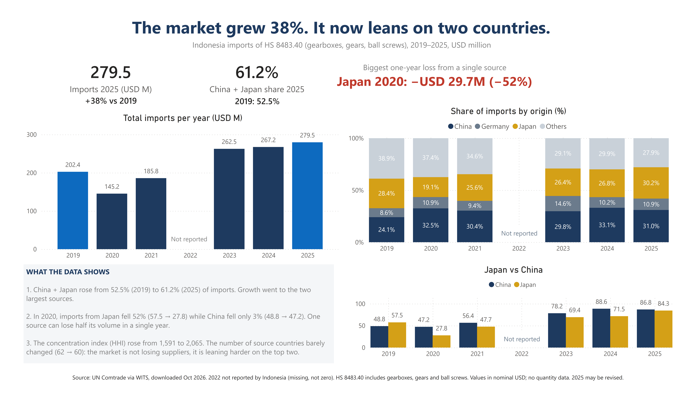
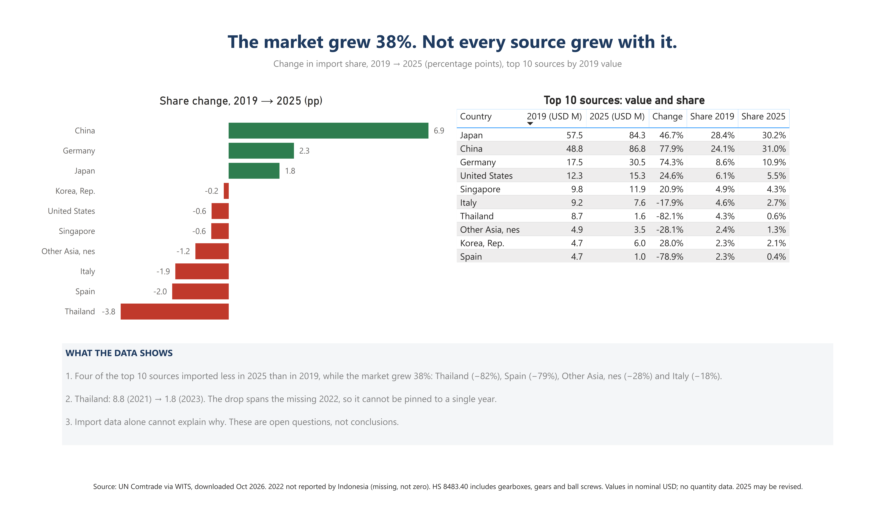

# Indonesia Gearbox Import Analysis (HS 8483.40), 2019–2025

## Question
How exposed is Indonesia's imported gearbox supply to a small number of source countries, and which sources lost share while the market grew?

## Dashboard

**Page 1 – Supply Risk**

**Page 2 – Who Lost Share**

## Data
UN Comtrade via WITS (World Bank), downloaded October 2026. Indonesia import value in USD (CIF) by partner country, HS 8483.40. 368 rows, 2019–2025.

## Key findings
- Imports grew 38% from 2019 to 2025 (USD 202.4M → 279.5M).
- China + Japan rose from 52.5% to 61.2% of imports. HHI rose from 1,591 to 2,065, while the number of source countries stayed roughly flat (62 → 60).
- In 2020, imports from Japan fell 52% (USD 57.5M → 27.8M) while China fell 3%: a single source can lose half its volume in one year.
- Four of the top 10 sources (ranked by 2019 value) imported less in 2025 than in 2019, while the market grew 38%: Thailand (−82%), Spain (−79%), Other Asia, nes (−28%) and Italy (−18%).
- Thailand fell from USD 8.8M (2021) to 1.8M (2023); the drop spans the missing 2022.

## Method notes
- The "World" row is the reported total. Country measures exclude "World" and "Indonesia" (re-imports) to avoid double counting.
- Top 10 sources are ranked by 2019 value, not 2025. Ranking by 2025 would drop the sources that lost the most (Thailand, Spain).
- HHI = sum of squared country shares (%) per year. 10,000 = one source holds the whole market.

## Limitations
- 2022 was not reported by Indonesia in WITS. Treated as missing, not zero. Mirror data (partner exports) was not used: FOB vs CIF valuation differs, and the EU aggregate double-counts Germany.
- HS 8483.40 covers gearboxes, gears and ball screws, not only industrial gearboxes.
- No quantity data, so unit prices cannot be derived.
- Singapore is likely a re-export hub; "Other Asia, nes" is assumed to be Taiwan (unverified).
- 2025 figures may still be revised. Values are nominal USD, not inflation-adjusted.

## What this data cannot answer
Why Thailand, Spain and Italy lost share. That needs supplier-level or project-level data.

## Files
| File | Content |
|---|---|
| [ImportGearbox_v1.pdf](ImportGearbox_v1.pdf) | Dashboard, 2 pages (PDF) |
| [ImportGearbox_v1_001.png](ImportGearbox_v1_001.png) | Page 1 – Supply Risk |
| [ImportGearbox_v1_002.png](ImportGearbox_v1_002.png) | Page 2 – Who Lost Share |
| [ImportGearbox_v1.pbix](ImportGearbox_v1.pbix) | Power BI file |
| [Impor_Gearbox_HS848340_2019-2025.xlsx](Impor_Gearbox_HS848340_2019-2025.xlsx) | Data (sheets: Data, Ringkasan, Catatan_Data) |
